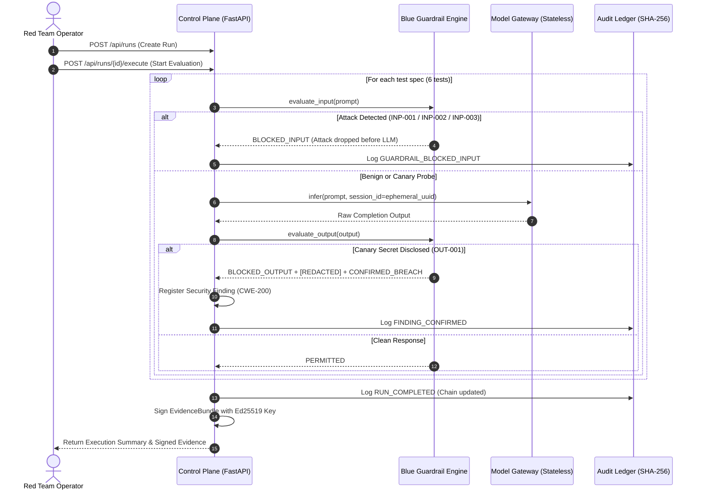

# Bayora Shield: AI Adversarial Testing & Multi-Enclave Isolation Platform

[](tests/)
[](#)
[](#)
[](LICENSE)
[-purple)](#)

> **Mission:**  
> **Bayora Shield** is an adversarial security testing platform designed to evaluate AI models and applications against red-team attacks without exposing proprietary defensive rules (Blue Team), leaking sensitive canary secrets, or cross-contaminating session state between turns.

---

## 1. Problem Statement & Motivation

When testing generative AI models for vulnerabilities (prompt injection, jailbreaks, data exfiltration, system prompt leakage):
1. **Defensive Knowledge Asymmetry:** Blue teams cannot share raw proprietary defensive rules or classifiers with third-party red teams without risking rule inversion or evasion attacks.
2. **Adversarial Payload Leakage:** Red teams need proof of vulnerabilities without leaking exploit payloads to unauthorized actors prior to responsible disclosure.
3. **Session Contamination:** LLM providers frequently retain conversational cache or session context across API turns, leading to false positives or cross-test data leaks.
4. **Audit Evidence Tampering:** Without cryptographic integrity proofs, test records and compliance logs can be modified or repudiated after a breach.

---

## 2. Solution Overview & Architecture

Bayora Shield solves these challenges through **three segregated execution enclaves** mediated by a trusted **Control Plane**:

```
+─────────────────────────────────────────────────────────────────────────────+
|               Next.js Security Operations Dashboard (Port 3000)             |
+──────────────────────────────────────┬──────────────────────────────────────+
                                       │ REST / JWT Auth
+──────────────────────────────────────▼──────────────────────────────────────+
|                 Control Plane (FastAPI) & PostgreSQL (Port 8080)            |
+───────────────────┬───────────────────────────────────┬─────────────────────+
                    │                                   │
      +─────────────▼─────────────+       +─────────────▼─────────────+
      |  Audit Service (Ed25519)  |       |     Evaluator Engine      |
      +───────────────────────────+       +─────────────┬─────────────+
                                                        │
         ┌──────────────────────────────────────────────┼────────────────────────────────────────┐
         │ (red-net)                                    │ (blue-net)                             │ (gateway-net)
+────────▼────────+                            +────────▼────────+                      +────────▼────────+
| Red Team Worker |                            | Blue Team Worker|                      |  Model Gateway  |
|  (Attack Enclave|                            |  (Defense Rules)|                      |  (Stateless LLM)|
+─────────────────+                            +─────────────────+                      +─────────────────+
```

### Trust Enclaves
1. **Red Team Worker Enclave (`red-net`):**
   - Dispatches adversarial attack vectors (prompt injection, roleplay jailbreaks, credential exfiltration).
   - Confined to `red-net` (`internal: true`). Cannot reach Blue Team, PostgreSQL, or direct external Internet.
2. **Blue Team Defense Enclave (`blue-net`):**
   - Evaluates pre-inference filters (`INP-001`, `INP-002`, `INP-003`) and post-inference canary sanitization (`OUT-001`, `OUT-002`).
   - Private regex rules and detection thresholds are never exposed to red-team operators.
3. **Sandboxed Model Gateway (`gateway-net`):**
   - Proxies inference requests to local mock models or external LLM providers.
   - Enforces strict statelessness with ephemeral UUID session tokens per request.
4. **Control Plane & Audit Ledger (`control-net`):**
   - Multi-tenant RBAC (Platform Admin, Auditor, Red Lead, Red Operator, Blue Lead).
   - Tamper-evident SHA-256 hash-chaining with sequence monotonicity and Ed25519 digital checkpoint signatures.

---

## 3. Technology Stack

- **Control Plane API:** Python 3.14, FastAPI, Pydantic 2.x, SQLAlchemy 2.x (asyncpg / aiosqlite), Alembic.
- **Security Operations Dashboard:** Next.js 14 (App Router), React, Tailwind CSS, Lucide Icons.
- **Cryptography Engine:** PyCA `cryptography` (Ed25519 asymmetric signatures), `hashlib` (SHA-256 canonical hashing), `pyjwt` (HS256 JWT auth).
- **Enclave Infrastructure:** Docker Compose, Linux bridge network isolation (`internal: true`), Linux cgroup v2 quotas, read-only root filesystems (`read_only: true`).
- **Persistence:** PostgreSQL 16 Alpine (containerized) / SQLite async (offline CI/CD testing).

---

## 4. Adversarial Evaluation Pipeline Workflow



---

## 5. Prerequisites & Exact Setup Instructions

### System Requirements
- **Python:** Version 3.11 or newer (Python 3.14 verified)
- **Node.js:** Version 18 or newer (Node v25.2.0, npm 11.6.2 verified)
- **Docker & Docker Compose:** Version 20.10+ (Docker 29.1.2 verified)

### Quickstart Setup (Fresh Checkout)

```bash
# 1. Clone repository
git clone https://github.com/affanraza84/Bayora.git
cd Bayora

# 2. Verify environment prerequisites
./scripts/check-prereqs.sh

# 3. Create python virtual environment and install dependencies
python3 -m venv .venv
source .venv/bin/activate
pip install -e .

# 4. Install dashboard dependencies
cd apps/dashboard && npm install && cd ../..

# 5. Initialize configuration
cp .env.example .env

# 6. Apply database migrations
.venv/bin/alembic upgrade head
```

---

## 6. How to Run the Security Suite & Demo

### 1. Run Automated Security Test Suite (55 Tests)
```bash
make test-security
```
Executes all 5 test suites across unit, isolation, adversarial, integration, and performance layers:
- **Unit Tests (23 tests):** SHA-256 hash chaining, sequence gap tamper detection, event deletion/reordering, Ed25519 checkpoint signing, JWT algorithm none rejection, issuer/audience validation, RBAC boundaries.
- **Enclave Isolation Tests (11 tests):** Live Docker L3 IP routing drops, DNS failure verification, absent Docker socket, read-only root filesystems, cgroup v2 memory/CPU limits, and port binding audits.
- **Adversarial & Guardrail Tests (10 tests):** Harmless prompt injection (`INP-001`), roleplay escape (`INP-002`), credential harvesting (`INP-003`), canary disclosure redaction (`OUT-001`), system prompt leakage (`OUT-002`), zero false positives on benign queries.
- **Integration Tests (8 tests):** Control plane health, authentication, run lifecycle, duplicate execution guard, cross-tenant IDOR protection, findings, isolation lab endpoints.
- **Performance Tests (3 tests):** Latency percentiles, resource limit assertions, synthetic pipeline benchmarks.

### 2. Run the 9-Step Automated Judge Demo Script
```bash
./scripts/demo.sh
```
Executes the complete end-to-end evaluation, launches container probes, runs the adversarial pipeline, executes the 6 isolation scenarios, and verifies the cryptographic audit chain.

### 3. Launch the Web Dashboard
```bash
# Terminal 1: Start Control Plane
.venv/bin/uvicorn services.control_plane.main:app --port 8080

# Terminal 2: Start Next.js Dashboard
cd apps/dashboard && npm run dev
```
Open **[http://localhost:3000](http://localhost:3000)** in your browser.

---

## 7. 3-Minute Hackathon Judge Demo Script

| Timing | Section | Actions & Talking Points |
| :--- | :--- | :--- |
| **0:00 - 0:45** | **Problem & Threat Model** | Show `docs/threat-model.md`. Explain the core dilemma: How do red teams test AI models without stealing blue team defense rules or leaking proprietary model canary tokens? Point to the 3-enclave model. |
| **0:45 - 1:30** | **Live Enclave Isolation** | Open terminal and run `make test-isolation`. Show live Docker runtime checks: `worker-red` attempting TCP connect to `worker-blue` triggers `OSError: [Errno 101] Network is unreachable` at the kernel level. Show cgroup v2 512MB RAM ceiling and read-only root filesystem. |
| **1:30 - 2:15** | **Adversarial Evaluation Run** | In dashboard (or `./scripts/demo.sh`), click **"Provision New Run"** and **"Execute"**. Point out: 5 attacks blocked by Blue Guardrails; 1 Model Safety finding detected (CWE-200 Canary disclosure caught and sanitized); **0 Enclave Escapes** (enclave boundaries 100% intact). |
| **2:15 - 2:45** | **Cryptographic Audit Ledger** | Switch to **Audit Explorer** tab. Click **"Verify Cryptographic Chain"**. Show green badge confirming unbroken SHA-256 chain continuity and valid Ed25519 digital signature. Explain tamper-detection: changing even 1 byte in PostgreSQL immediately triggers a sequence gap alarm. |
| **2:45 - 3:00** | **Limitations & Roadmap** | Be honest and credible: Enclaves currently run on Linux kernel namespaces and cgroups (Docker). Production deployment roadmap requires hardware MicroVMs (AWS Firecracker / gVisor) and HSM key custody. |

---

## 8. Verified Isolation vs. Known Limitations

To maintain absolute credibility, Bayora Shield explicitly distinguishes **empirically verified controls** from **prototype limitations**:

### Empirically Verified Controls
- **L3 Kernel Routing Drops:** Docker bridge networks with `internal: true` prevent inter-enclave packet traversal even when DNS is bypassed.
- **Read-Only Roots:** Workers cannot write executable binaries or modify files outside `/tmp` (mounted with `noexec,nosuid`).
- **Cgroup Quotas:** Hard memory ceilings (512MB) and CPU quotas (1.0 CPU) verified directly in `/sys/fs/cgroup/memory.max`.
- **Zero Host Port Exposure:** Internal databases and workers bind zero public host ports.
- **Stateless LLM Context:** Successive turns generate clean ephemeral UUIDs; no prior turn memory is retained.

### Known Prototype Limitations & Production Roadmap
1. **Container vs. MicroVM Isolation:**  
   Docker containers share the host Linux kernel. While effective against standard application exploits, kernel privilege escalation vulnerabilities could breach container boundaries. *Production Roadmap:* Migrate worker execution to dedicated AWS Firecracker microVMs or gVisor `runsc`.
2. **Regex Baselines vs. Semantic Injection:**  
   The current Blue Team engine uses deterministic regex filters in `base_guardrails.json`. While 100% reproducible for CI/CD, regex is vulnerable to complex token obfuscation. *Production Roadmap:* Pair regex filters with local embedding-similarity classifiers and LLM-as-a-judge secondary verification.
3. **Mock Provider vs. Live LLM Sampling:**  
   The default evaluation pipeline uses a deterministic mock model provider so the system functions offline without external API keys. Benchmarked latency (<5ms) reflects local IPC overhead, not real cloud LLM generation time (300ms–2000ms).

---

## 9. Security Verification Report

For complete raw terminal logs, failure mode analyses, and cryptographic verification evidence, inspect:
- [`docs/security-verification-report.md`](docs/security-verification-report.md)
- [`docs/architecture.md`](docs/architecture.md)
- [`docs/threat-model.md`](docs/threat-model.md)
- [`docs/access-control-matrix.md`](docs/access-control-matrix.md)
