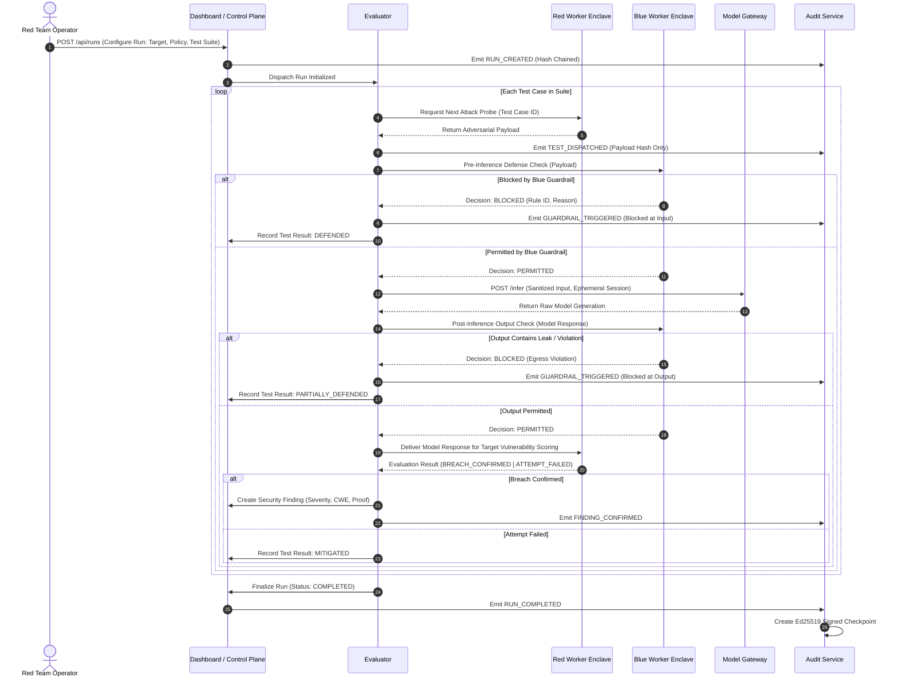

# Bayora Shield: Architecture Specification

## 1. Executive Summary & Core Mission

**Bayora Shield** is an adversarial security testing infrastructure platform designed to evaluate AI models and applications against automated and human red-team operations without exposing proprietary defensive policies (Blue Team) or leaking adversarial payloads prior to authorized disclosure.

The platform orchestrates multi-agent or worker-based security evaluations across three isolated execution enclaves:
1. **Red Team Workers:** Execute authorized adversarial payloads (prompt injections, jailbreaks, data exfiltration probes, model inversion queries) without direct access to defense configurations or client model backends.
2. **Blue Team Defense Enclave:** Applies private defense policies, input/output guardrails, filtering rules, and heuristic sanitizers without exposing private rule source code or training data to red-team operators.
3. **Model Gateway / Client LLM Proxy:** Executes model inference inside a sandboxed network context, shielded from direct red-team network access and preventing outbound data exfiltration.

All interactions are mediated by a **Trusted Control Plane** backed by a **Tamper-Evident Audit Service** that records immutable, SHA-256 hash-chained event logs signed periodically with Ed25519 digital signatures.

---

## 2. Trust Domains & System Boundaries

```
+-----------------------------------------------------------------------------------+
|                              UNTRUSTED USER DOMAIN                                |
|                                                                                   |
|  [ Red Team Operator ]     [ Blue Team Operator ]     [ Auditor / Compliance ]   |
|         │                            │                           │                |
+─────────┼────────────────────────────┼───────────────────────────┼────────────────+
          │ (HTTPS / TLS 1.3)          │ (HTTPS / TLS 1.3)         │ (HTTPS / TLS 1.3)
          ▼                            ▼                           ▼
+───────────────────────────────────────────────────────────────────────────────────+
|                           EDGE & DASHBOARD DOMAIN                                 |
|                                                                                   |
|  [ Next.js Security Operations Dashboard (apps/dashboard) ]                       |
|  - Role-based views (Red, Blue, Auditor, Admin)                                   |
|  - Real-time run telemetry, findings review, isolation lab, audit verification    |
+──────────────────────────────────────┬────────────────────────────────────────────+
                                       │ REST / mTLS
                                       ▼
+───────────────────────────────────────────────────────────────────────────────────+
|                         TRUSTED CONTROL DOMAIN                                    |
|                                                                                   |
|  [ Control Plane API (FastAPI) ]                                                  |
|  - Authentication & RBAC enforcement                                              |
|  - Tenant isolation & run orchestration                                           |
|  - Policy registry & artifact entitlement checks                                  |
|                                                                                   |
|  [ Database (PostgreSQL) ]                [ Audit Service ]                       |
|  - Users, tenants, runs, findings        - Append-only hash chain                |
|  - No raw secrets / keys stored          - Ed25519 audit checkpoints             |
+───────────────┬───────────────────────────────────────┬───────────────────────────+
                │ Internal Task Queue / Dispatch        │ Verified Audit Events
                ▼                                       ▼
+───────────────────────────────────────────────────────────────────────────────────+
|                         EXECUTION ENCLAVES (ISOLATED)                             |
|                                                                                   |
|  +-----------------------------+           +-----------------------------+        |
|  | Red-Team Worker Enclave     |           | Blue-Team Defense Enclave   |        |
|  | (Network: red-net)          |           | (Network: blue-net)         |        |
|  | - Executes probe generators |           | - Pre-inference guardrails  |        |
|  | - No access to blue rules   |           | - Post-inference sanitizers |        |
|  | - No direct LLM access      |           | - Rule telemetry (redacted) |        |
|  +──────────────┬──────────────+           +──────────────┬──────────────+        |
|                 │                                         │                       |
|                 │ Send payload via Evaluator              │ Evaluate & Filter     |
|                 └───────────────────► ◄───────────────────┘                       |
|                                       │                                           |
|                                       ▼                                           |
|                    +------------------------------------+                         |
|                    | Evaluator Orchestrator (Core Loop) |                         |
|                    +──────────────────┬─────────────────+                         |
|                                       │ Sanitized Request (model-net)             |
|                                       ▼                                           |
|                    +------------------------------------+                         |
|                    | Model Gateway / Proxy              |                         |
|                    | (Network: model-net)               |                         |
|                    | - Sandboxed LLM client adapter     |                         |
|                    | - Token budgeting & egress control |                         |
|                    +────────────────────────────────────+                         |
+───────────────────────────────────────────────────────────────────────────────────+
```

### Trust Boundary Classification

| Component | Trust Level | Capabilities | Invariants & Constraints |
| :--- | :--- | :--- | :--- |
| **Dashboard (Next.js)** | Untrusted Client | UI rendering, user interaction, token transport | No direct DB or internal network access. All operations authenticate through Control Plane. |
| **Control Plane (FastAPI)** | Trusted Core | Tenant dispatch, token verification, RBAC, job scheduling | Enforces tenant scoping on all artifact requests. Does not store plaintext private keys. |
| **Database (PostgreSQL)** | Trusted Store | Relational persistence of metadata, runs, findings | Accessible solely by Control Plane and Audit Service over private network. |
| **Audit Service** | Trusted Cryptographic Verifier | Computes SHA-256 event chains, produces Ed25519 signed checkpoints | Append-only store. Rejects retrospective mutation or re-indexing of entries. |
| **Evaluator** | Semi-Trusted Orchestrator | Intermediary between Red Worker, Blue Worker, and Model Gateway | Mediates evaluation step-by-step; redacts private payloads before sending to blue metrics. |
| **Red-Team Worker** | Untrusted / Adversarial | Generates attack payloads, analyzes sanitized responses | Isolated in `red-net`. Zero network access to `blue-net`, `model-net`, or `control-plane` DB. |
| **Blue-Team Worker** | Semi-Trusted Defensive | Runs regex, semantic classifiers, and prompt shields | Isolated in `blue-net`. Zero direct access to Red payload repositories or Red metadata. |
| **Model Gateway** | Constrained Proxy | Dispatches inferencing to mock LLM or external LLM API | Isolated in `model-net`. Outbound internet strictly gated to approved model endpoints. |

---

## 3. Detailed Component Architecture

### 3.1 Control Plane (`services/control-plane`)
- **Framework:** FastAPI with Python 3.11+, Pydantic v2 schemas.
- **Responsibilities:**
  - Authenticates users via signed JWTs (Bearer tokens).
  - Enforces Role-Based Access Control (RBAC): `platform_admin`, `auditor`, `red_lead`, `red_operator`, `blue_lead`, `blue_operator`.
  - Manages tenant boundaries: Multi-tenant partitioning guarantees Tenant A cannot view Tenant B's runs or artifacts.
  - Registers policies and sets up evaluation tasks.
  - Coordinates execution with the `Evaluator` daemon.

### 3.2 Evaluator Engine (`services/evaluator`)
- **Responsibilities:**
  - Manages the state machine for an **Evaluation Run**: `PENDING -> INITIALIZING -> RUNNING -> COMPLETED | FAILED | ABORTED`.
  - Coordinates step-level test execution:
    1. Fetches test case payload from Red Worker enclave.
    2. Passes input through Blue Team pre-execution guardrail.
    3. If blocked: records defensive mitigation event, flags test case as Defended.
    4. If permitted: forwards request through Model Gateway.
    5. Passes model output through Blue Team post-execution guardrail.
    6. Returns sanitized response to Red Team Worker for attack evaluation.
    7. Emits structured findings to Control Plane and audit events to Audit Service.

### 3.3 Audit Service (`services/audit-service`)
- **Responsibilities:**
  - Collects security-relevant events (`RUN_CREATED`, `TEST_DISPATCHED`, `GUARDRAIL_TRIGGERED`, `FINDING_CONFIRMED`, `CHECKPOINT_SIGNED`).
  - Maintains a cryptographic SHA-256 hash chain:
    $$\text{Hash}_n = \text{SHA-256}(\text{Hash}_{n-1} \parallel \text{Seq}_n \parallel \text{Timestamp} \parallel \text{Actor} \parallel \text{Action} \parallel \text{Resource} \parallel \text{PayloadDigest})$$
  - Periodically batches chain state and signs audit checkpoints with an Ed25519 private key.
  - Exposes an independent verification endpoint (`POST /api/audit/verify`) capable of validating chain continuity and digital signatures.

### 3.4 Model Gateway (`services/model-gateway`)
- **Responsibilities:**
  - Acts as an egress-controlled gateway to underlying LLM instances (local llama.cpp / vLLM or cloud API endpoints).
  - Enforces per-run rate limits, max token ceilings, and request timeout deadlines.
  - Strips ambient session metadata to eliminate cross-session prompt caching or context contamination.

### 3.5 Isolated Worker Services (`services/workers/`)
- **Red-Team Worker (`services/workers/red-team`):**
  - Runs adversarial suites (e.g., OWASP Top 10 for LLMs, prompt injections, system prompt leak extraction).
  - Emits candidate attack vectors to the evaluator over an internal RPC interface.
- **Blue-Team Worker (`services/workers/blue-team`):**
  - Houses defensive rules: regex pattern filters, heuristic toxicity scorers, embedding-based intent firewalls.
  - Evaluates inputs without saving or retaining adversarial prompt payloads in persistent storage.

---

## 4. Network Boundaries & Docker Network Topology

To maintain least privilege, the infrastructure defines four segmented Docker bridge networks:

1. **`control-net` (Internal):** Connects `control-plane`, `dashboard`, `database`, and `audit-service`.
2. **`evaluator-net` (Internal):** Connects `control-plane`, `evaluator`, and `audit-service`.
3. **`red-net` (Isolated):** Connects `evaluator` and `workers/red-team`. `red-team` has NO access to `control-net`, `blue-net`, or `model-net`.
4. **`blue-net` (Isolated):** Connects `evaluator` and `workers/blue-team`. `blue-team` has NO access to `control-net`, `red-net`, or `model-net`.
5. **`model-net` (Constrained):** Connects `evaluator` and `model-gateway`.

```
                    +-------------------------------------------------+
                    |                   control-net                   |
                    |  [dashboard] <-> [control-plane] <-> [database] |
                    |                          ^                      |
                    +──────────────────────────┼──────────────────────+
                                               │
                                    +──────────▼──────────+
                                    |    audit-service    |
                                    +──────────▲──────────+
                                               │
                    +--------------------------┼----------------------+
                    |                   evaluator-net                 |
                    |                     [evaluator]                 |
                    +─────────────┬────────────┼───────────┬──────────+
                                  │            │           │
            +─────────────────────+            │           +─────────────────────+
            │                                  │                                 │
+───────────▼───────────+          +───────────▼───────────+         +───────────▼───────────+
|        red-net        |          |       blue-net        |         |       model-net       |
|  [workers/red-team]   |          |  [workers/blue-team]  |         |    [model-gateway]    |
+───────────────────────+          +───────────────────────+         +───────────────────────+
```

---

## 5. Model Evaluation Lifecycle



---

## 6. Audit-Event Lifecycle & Cryptographic Integrity

1. **Generation:** When an authorized state transition occurs, the responsible service dispatches a structured event payload to the `Audit Service`.
2. **Canonical Serialization:** The event payload is serialized into canonical JSON (sorted keys, no whitespace padding, UTC ISO-8601 timestamps).
3. **Hash Computation:**
   - The SHA-256 hash of the canonical payload is computed.
   - The new chain link hash is computed:
     $$H_i = \text{SHA-256}(H_{i-1} \parallel i \parallel \text{timestamp} \parallel \text{payload\_sha256})$$
4. **Append:** The record is written with sequence index $i$, timestamp, $H_{i-1}$, and $H_i$.
5. **Periodic Checkpoint Signing:** Every $K$ events or upon run completion:
   - A checkpoint payload containing `(start_seq, end_seq, root_hash, timestamp)` is signed using the platform's private Ed25519 key.
   - The signature is stored alongside the checkpoint record.
6. **External Verification:**
   - Any authorized auditor can invoke `POST /api/audit/verify` with a sequence window.
   - The engine iterates through the chain, recomputes each $H_i$, checks $H_i == H_{\text{stored}}$, and verifies the Ed25519 signature against the published public key.

---

## 7. Storage & Data Persistence Boundaries

- **Relational Storage (PostgreSQL):**
  - Scoped by `tenant_id`. Every query issued by the Control Plane enforces `WHERE tenant_id = :tenant_id`.
  - Tables: `users`, `tenants`, `evaluation_runs`, `test_cases`, `findings`, `audit_events`, `policy_versions`.
  - **Zero Raw Secrets Policy:** API keys, database credentials, and Ed25519 private keys are injected strictly via container environment variables or mounted files; they are never persisted in PostgreSQL.
- **Artifact Storage (Local Volume / S3 Mock):**
  - Segmented directory paths:
    - `/artifacts/tenants/{tenant_id}/red/{run_id}/` (Red Team payloads)
    - `/artifacts/tenants/{tenant_id}/blue/{policy_id}/` (Blue Team defense rules)
    - `/artifacts/tenants/{tenant_id}/evidence/{run_id}/` (Redacted findings & signed audit bundles)
  - Enclave workers mount ONLY their respective directories in read-only mode during run execution.

---

## 8. Deployment Architecture (Hackathon Proof of Concept)

In Phase 1 and 2, the system runs locally via Docker Compose with explicit network bridges:

| Container Service | Base Image | Ports Exposed | Networks |
| :--- | :--- | :--- | :--- |
| `dashboard` | `node:20-alpine` | `3000:3000` (Host) | `control-net` |
| `control-plane` | `python:3.11-slim` | `8000:8000` (Host optional for dev) | `control-net`, `evaluator-net` |
| `database` | `postgres:16-alpine`| `5432:5432` (Host mapped for dev) | `control-net` |
| `audit-service` | `python:3.11-slim` | Internal only | `control-net`, `evaluator-net` |
| `evaluator` | `python:3.11-slim` | Internal only | `evaluator-net`, `red-net`, `blue-net`, `model-net` |
| `worker-red-team` | `python:3.11-slim` | Internal only | `red-net` |
| `worker-blue-team`| `python:3.11-slim` | Internal only | `blue-net` |
| `model-gateway` | `python:3.11-slim` | Internal only | `model-net` |

---

## 9. Evolution Beyond Hackathon (Production Roadmap)

1. **Hardware & MicroVM Isolation:** Replace Docker containers for Red and Blue workers with Firecracker MicroVMs or gVisor (`runsc`) to prevent kernel-level container escapes.
2. **KMS / HSM Integration:** Replace disk-based Ed25519 signing keys with AWS KMS, HashiCorp Vault Transit engine, or hardware security modules.
3. **Confidential Computing:** Run the Evaluator inside AMD SEV-SNP or Intel SGX enclaves to ensure neither cloud administrators nor co-tenants can inspect memory contents during test evaluation.
