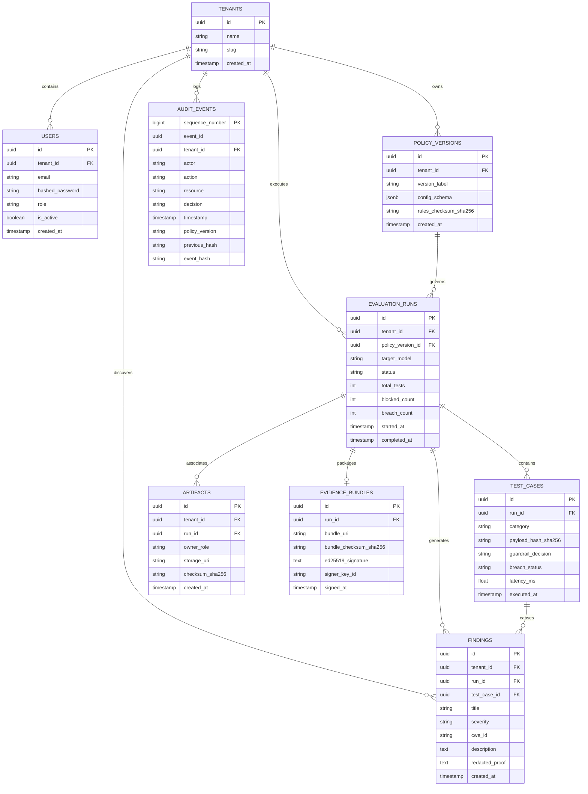

# Bayora Shield: Evaluation Data Model & Relational Schema

## 1. Overview & Data Security Principles

The Bayora Shield data layer stores users, evaluation runs, defensive policies, security findings, and tamper-evident audit records in a multi-tenant PostgreSQL relational database.

### Core Data Security Guarantees
1. **Multi-Tenant Partitioning:** Every core table includes a `tenant_id` foreign key. Queries are restricted to the tenant context derived from the verified authentication JWT.
2. **Zero Plaintext Secrets:** Under no circumstance are provider API keys (e.g. OpenAI/Anthropic keys) or Ed25519 private signing keys stored in database rows. Secrets are loaded via secure container environment variables or hardware key stores.
3. **Audit Immutability:** Audit events are append-only. Each audit record contains the SHA-256 digest of the previous record, forming an unbroken cryptographic chain.

---

## 2. Entity Definitions

### 2.1 Tenant & User
- **`Tenant`**: Isolates organizations or evaluation environments (e.g., "Fintech Corp Security Evaluation").
- **`User`**: Human operator identity authenticated via username/email and password hash (Argon2id/bcrypt). Holds an assigned role (`platform_admin`, `auditor`, `red_lead`, `red_operator`, `blue_lead`, `blue_operator`).

### 2.2 Policy Version (`policy_versions`)
- Represents a discrete version of the Blue Team's defensive guardrails (regex rules, semantic filters, threshold configurations).
- Pointers to rule definitions are versioned so that historical evaluation runs can be evaluated against the exact defense version active at test time.

### 2.3 Evaluation Run (`evaluation_runs`)
- Encapsulates a complete adversarial evaluation campaign.
- Tracks target model identifier, status (`PENDING`, `INITIALIZING`, `RUNNING`, `COMPLETED`, `FAILED`, `ABORTED`), metrics, start/end timestamps, and active `policy_version_id`.

### 2.4 Test Case (`test_cases`)
- Represents an individual probe or adversarial turn within an evaluation run.
- Captures category (e.g., `PROMPT_INJECTION`, `JAILBREAK`, `DATA_EXFILTRATION`, `SYSTEM_PROMPT_LEAK`), input payload hash, defense decision (`PERMITTED` or `BLOCKED`), execution latency, and breach assessment.

### 2.5 Artifact (`artifacts`)
- Metadata catalog for input payload files, defense rule files, and evaluation outputs.
- Contains storage URI (local or S3), SHA-256 content checksum, owner role (`red` or `blue`), and visibility scope.

### 2.6 Security Finding (`findings`)
- Confirmed vulnerability or defense failure flagged during a run.
- Contains severity rating (`CRITICAL`, `HIGH`, `MEDIUM`, `LOW`, `INFORMATIONAL`), CWE identifier (e.g., CWE-200, CWE-77), proof of breach (redacted snippet), and remediation recommendations.

### 2.7 Audit Event (`audit_events`)
- Cryptographically chained record of a significant security action.
- Fields:
  - `sequence_number` (monotonic integer: 1, 2, 3...)
  - `event_id` (UUIDv4)
  - `actor` (e.g. `user:red_lead@bayora.io` or `svc:evaluator`)
  - `action` (e.g. `RUN_TRIGGERED`, `PAYLOAD_DISPATCHED`, `GUARDRAIL_BLOCKED`, `FINDING_ASSERTED`)
  - `resource` (e.g. `run:run_98231` or `policy:pol_441`)
  - `decision` (e.g. `ALLOW`, `DENY`, `CONFIRMED`)
  - `timestamp` (UTC ISO-8601 with microsecond precision)
  - `policy_version` (String / UUID)
  - `previous_hash` (Hex SHA-256 of the immediate predecessor event)
  - `event_hash` (Hex SHA-256 calculated over canonical serialized fields)

### 2.8 Evidence Bundle (`evidence_bundles`)
- Comprehensive zip or tar package containing the signed audit export, anonymized findings, and Ed25519 checkpoint signature for export to compliance regulators or third-party auditors.

---

## 3. Entity-Relationship Diagram (ERD)



---

## 4. Proposed PostgreSQL DDL (Schema)

```sql
-- Extensions
CREATE EXTENSION IF NOT EXISTS "uuid-ossp";
CREATE EXTENSION IF NOT EXISTS "pgcrypto";

-- Tenants
CREATE TABLE tenants (
    id UUID PRIMARY KEY DEFAULT gen_random_uuid(),
    name VARCHAR(255) NOT NULL,
    slug VARCHAR(100) UNIQUE NOT NULL,
    created_at TIMESTAMPTZ NOT NULL DEFAULT NOW()
);

-- Users
CREATE TABLE users (
    id UUID PRIMARY KEY DEFAULT gen_random_uuid(),
    tenant_id UUID NOT NULL REFERENCES tenants(id) ON DELETE CASCADE,
    email VARCHAR(255) UNIQUE NOT NULL,
    hashed_password VARCHAR(255) NOT NULL,
    role VARCHAR(50) NOT NULL CHECK (role IN (
        'platform_admin', 'auditor', 'red_lead', 'red_operator', 'blue_lead', 'blue_operator'
    )),
    is_active BOOLEAN NOT NULL DEFAULT TRUE,
    created_at TIMESTAMPTZ NOT NULL DEFAULT NOW()
);

-- Policy Versions (Blue Team defensive rules)
CREATE TABLE policy_versions (
    id UUID PRIMARY KEY DEFAULT gen_random_uuid(),
    tenant_id UUID NOT NULL REFERENCES tenants(id) ON DELETE CASCADE,
    version_label VARCHAR(50) NOT NULL,
    config_schema JSONB NOT NULL DEFAULT '{}'::jsonb,
    rules_checksum_sha256 CHAR(64) NOT NULL,
    created_at TIMESTAMPTZ NOT NULL DEFAULT NOW(),
    UNIQUE (tenant_id, version_label)
);

-- Evaluation Runs
CREATE TABLE evaluation_runs (
    id UUID PRIMARY KEY DEFAULT gen_random_uuid(),
    tenant_id UUID NOT NULL REFERENCES tenants(id) ON DELETE CASCADE,
    policy_version_id UUID REFERENCES policy_versions(id) ON DELETE SET NULL,
    target_model VARCHAR(100) NOT NULL,
    status VARCHAR(50) NOT NULL DEFAULT 'PENDING' CHECK (status IN (
        'PENDING', 'INITIALIZING', 'RUNNING', 'COMPLETED', 'FAILED', 'ABORTED'
    )),
    total_tests INT NOT NULL DEFAULT 0,
    blocked_count INT NOT NULL DEFAULT 0,
    breach_count INT NOT NULL DEFAULT 0,
    started_at TIMESTAMPTZ,
    completed_at TIMESTAMPTZ,
    created_at TIMESTAMPTZ NOT NULL DEFAULT NOW()
);

-- Test Cases
CREATE TABLE test_cases (
    id UUID PRIMARY KEY DEFAULT gen_random_uuid(),
    run_id UUID NOT NULL REFERENCES evaluation_runs(id) ON DELETE CASCADE,
    category VARCHAR(50) NOT NULL CHECK (category IN (
        'PROMPT_INJECTION', 'JAILBREAK', 'DATA_EXFILTRATION', 'SYSTEM_PROMPT_LEAK', 'RESOURCE_DOS'
    )),
    payload_hash_sha256 CHAR(64) NOT NULL,
    guardrail_decision VARCHAR(50) NOT NULL CHECK (guardrail_decision IN (
        'PERMITTED', 'BLOCKED_INPUT', 'BLOCKED_OUTPUT'
    )),
    breach_status VARCHAR(50) NOT NULL CHECK (breach_status IN (
        'NO_BREACH', 'CONFIRMED_BREACH', 'PARTIAL_LEAK', 'UNKNOWN'
    )),
    latency_ms REAL NOT NULL DEFAULT 0.0,
    executed_at TIMESTAMPTZ NOT NULL DEFAULT NOW()
);

-- Security Findings
CREATE TABLE findings (
    id UUID PRIMARY KEY DEFAULT gen_random_uuid(),
    tenant_id UUID NOT NULL REFERENCES tenants(id) ON DELETE CASCADE,
    run_id UUID NOT NULL REFERENCES evaluation_runs(id) ON DELETE CASCADE,
    test_case_id UUID REFERENCES test_cases(id) ON DELETE SET NULL,
    title VARCHAR(255) NOT NULL,
    severity VARCHAR(20) NOT NULL CHECK (severity IN (
        'CRITICAL', 'HIGH', 'MEDIUM', 'LOW', 'INFORMATIONAL'
    )),
    cwe_id VARCHAR(50) NOT NULL,
    description TEXT NOT NULL,
    redacted_proof TEXT NOT NULL,
    created_at TIMESTAMPTZ NOT NULL DEFAULT NOW()
);

-- Artifacts Metadata
CREATE TABLE artifacts (
    id UUID PRIMARY KEY DEFAULT gen_random_uuid(),
    tenant_id UUID NOT NULL REFERENCES tenants(id) ON DELETE CASCADE,
    run_id UUID REFERENCES evaluation_runs(id) ON DELETE CASCADE,
    owner_role VARCHAR(20) NOT NULL CHECK (owner_role IN ('red', 'blue', 'audit')),
    storage_uri VARCHAR(512) NOT NULL,
    checksum_sha256 CHAR(64) NOT NULL,
    created_at TIMESTAMPTZ NOT NULL DEFAULT NOW()
);

-- Audit Events (Tamper-evident append-only log)
CREATE TABLE audit_events (
    sequence_number BIGSERIAL PRIMARY KEY,
    event_id UUID UNIQUE NOT NULL DEFAULT gen_random_uuid(),
    tenant_id UUID NOT NULL REFERENCES tenants(id) ON DELETE CASCADE,
    actor VARCHAR(255) NOT NULL,
    action VARCHAR(100) NOT NULL,
    resource VARCHAR(255) NOT NULL,
    decision VARCHAR(50) NOT NULL,
    timestamp TIMESTAMPTZ NOT NULL DEFAULT NOW(),
    policy_version VARCHAR(100) NOT NULL,
    previous_hash CHAR(64) NOT NULL,
    event_hash CHAR(64) NOT NULL
);

-- Evidence Bundles
CREATE TABLE evidence_bundles (
    id UUID PRIMARY KEY DEFAULT gen_random_uuid(),
    run_id UUID UNIQUE NOT NULL REFERENCES evaluation_runs(id) ON DELETE CASCADE,
    bundle_uri VARCHAR(512) NOT NULL,
    bundle_checksum_sha256 CHAR(64) NOT NULL,
    ed25519_signature TEXT NOT NULL,
    signer_key_id VARCHAR(100) NOT NULL,
    signed_at TIMESTAMPTZ NOT NULL DEFAULT NOW()
);

-- Indexes for performance & scoping
CREATE INDEX idx_eval_runs_tenant ON evaluation_runs(tenant_id, status);
CREATE INDEX idx_test_cases_run ON test_cases(run_id);
CREATE INDEX idx_findings_tenant ON findings(tenant_id, severity);
CREATE INDEX idx_audit_events_seq ON audit_events(sequence_number ASC);
CREATE INDEX idx_audit_events_tenant ON audit_events(tenant_id, timestamp);
```

---

## 5. Canonical Audit Hash Calculation

The `event_hash` for audit sequence $n$ is calculated deterministically as:

```python
import hashlib
import json

def compute_audit_hash(
    prev_hash: str,
    seq: int,
    event_id: str,
    actor: str,
    action: str,
    resource: str,
    decision: str,
    iso_timestamp: str,
    policy_ver: str,
    payload_digest: str,
) -> str:
    # Deterministic Canonical JSON
    payload = {
        "action": action,
        "actor": actor,
        "decision": decision,
        "event_id": event_id,
        "payload_digest": payload_digest,
        "policy_version": policy_ver,
        "previous_hash": prev_hash,
        "resource": resource,
        "sequence_number": seq,
        "timestamp": iso_timestamp,
    }
    canonical_string = json.dumps(payload, sort_keys=True, separators=(",", ":"))
    return hashlib.sha256(canonical_string.encode("utf-8")).hexdigest()
```
